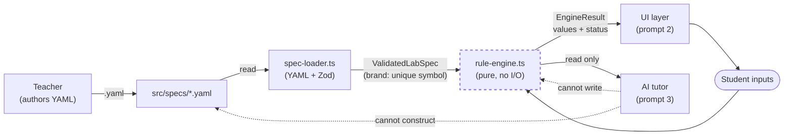

# Architecture — how truth flows through the framework

The framework has one job: turn a teacher-authored YAML file into a running
virtual lab where every scientific outcome is deterministic and every
motivational touch is delegated to an AI tutor that cannot compute science.
This document is one page. If it gets longer, we've lost the shape.

## The flow



The dashed lines are what matters: **the AI tutor can READ from
`EngineResult` and quote a value with its `status`, but it can neither
write to the engine nor construct a `ValidatedLabSpec` to feed it**. This
is the mechanical enforcement of Principle 8.

## The five modules and their contracts

| Module                    | Path                                                | Contract                                                                                        |
| ------------------------- | --------------------------------------------------- | ----------------------------------------------------------------------------------------------- |
| Teacher-authored spec     | `src/specs/*.yaml`                                  | Human-readable YAML. Referenced from tests, loader, and future authoring UI. Never `import`-ed. |
| Schema (types + Zod)      | `src/schema/lab-spec*.ts`                           | Declares `LabSpec`, `ValidatedLabSpec`, `PublicLabSpec`, and the runtime validator.             |
| Loader                    | `src/loader/spec-loader.ts`, `src/app/lib/get-lab-spec.ts` | The ONLY producer of `ValidatedLabSpec`. `get-lab-spec.ts` is the Next.js entry, `server-only`. |
| Engine                    | `src/engine/*.ts`                                   | Pure function of `(ValidatedLabSpec, inputs) → EngineResult`. No `fetch`, no `eval`, no LLM.    |
| UI shell (Next.js)        | `src/app/**`, `src/components/**`                   | Consumes `PublicLabSpec` (unbranded) and `EngineResult`. Never imports `runLab` client-side.    |
| AI tutor (future)         | prompt 4                                            | Reads `EngineResult`. Never imports from `schema/lab-spec.ts` directly.                          |

## The "use client" split — the `session-shared` / `session-state` pattern

Next.js RSC treats every export from a `"use client"` file as client-only.
That's correct for React Context and hooks, but it wrongly infects plain
constants and helper functions that a server component would like to
import. To keep the boundary clean without prop-drilling every constant
through props, the shell splits its session module into two files:

- **`src/app/lib/session-shared.ts`** — no `"use client"`, no React imports.
  Exports plain data: `PhaseId`, `PHASE_ORDER`, `PHASE_LABELS`,
  `SUBMITTABLE_PHASES`, `UNLOCK_NEXT`, `COMING_SOON`, `PhaseStatus`,
  `PhaseState`, `LabSessionState`, `initialSessionState()`, `wordCount()`,
  `progressFraction()`. Safe to import from **both** server and client
  components.

- **`src/app/lib/session-state.ts`** — `"use client"`. Adds the React
  Context (`LabSessionContext`) and the `useLabSession()` hook. Re-exports
  everything from `session-shared` so that client components have a single
  import site.

**The rule for future maintainers.** A server component (any page under
`src/app/**` without `"use client"`, plus every file in
`src/components/spec-content/**`) must import from `session-shared`, not
`session-state`. A client component may import from either; prefer
`session-state` so the hook is co-located with the constants. Splitting a
module this way whenever a mixed-use client file emerges is the pattern —
it beats duplicating constants and it beats stapling `"use client"` onto
files that don't need it.

## The type-system boundary that stops the AI

```ts
// src/schema/lab-spec.ts
declare const validatedLabSpecBrand: unique symbol;
export type ValidatedLabSpec = LabSpec & {
  readonly [validatedLabSpecBrand]: true;
};
export function asValidatedLabSpec(spec: LabSpec): ValidatedLabSpec {
  return spec as ValidatedLabSpec;  // sole producer
}

// src/engine/rule-engine.ts
export function runLab(spec: ValidatedLabSpec, inputs: EngineInputs): EngineResult { ... }
```

`validatedLabSpecBrand` is `declare const` — a phantom symbol with no
runtime existence. It cannot be constructed from outside this file at
runtime, and TypeScript will refuse a plain `LabSpec` literal at the
`runLab` call site. The loader is the sole entrypoint because it is the
sole caller of `asValidatedLabSpec`. Removing this brand, or reintroducing
`LabSpec` on the engine's signature, breaks the build — `tests/brand.test.ts`
carries a `@ts-expect-error` guard that would then complain.

## What still isn't in the type system

Two claims are enforced by code review + tests, not by types:

1. **The loader itself doesn't call an LLM.** It's a few lines of `js-yaml`
   + `zod`; a `principles.test.ts` grep-style test could later assert no
   `fetch`/`Anthropic` imports appear in `src/engine/` or `src/loader/`. Not
   worth writing yet; add it when the tutor package lands.
2. **The tutor doesn't import from `src/schema/lab-spec.ts` and hand-cast a
   spec.** Convention-only until a future ESLint boundary rule can forbid
   that import from the tutor package.

## Testing the flow end-to-end

`tests/engine.test.ts` and `tests/engine-undefined.test.ts` walk the flow
from a real YAML file through the loader through the engine to numeric
results — the same path the UI will use. If those tests pass, the flow is
intact. See `principle-mapping.md` for which test covers which principle.
